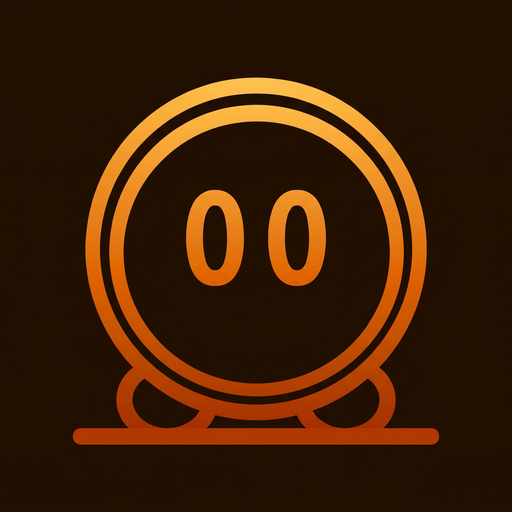

# TeeVisuals 🟠

<p align="center">
  
</p>

<p align="center">
  <strong>Next-Generation Cross-Platform DDNet / Teeworlds Client</strong><br>
  Featuring Dynamic Island HUD, Smooth Bindwheel, Player Lists & War System, and Cactus-Inspired Visuals.
</p>

<p align="center">
  <a href="https://github.com/qkryt/TeeVisuals/actions/workflows/build.yml"></a>
  
  
  
</p>

---

## 🌟 Highlights & Features

### 🏝️ Dynamic Island HUD
- **Signature Pill Design**: Elegant rounded glassmorphic capsule centered at the top of the screen.
- **Warm Orange-Yellow Accent**: Glowing gradient stroke (`#FF8C00 -> #FFB800 -> #FFE066`) with glassmorphism dark background.
- **Real-Time Telemetry**:
  - Mini embedded TeeVisuals logo
  - Real-time player latency (`{ping} ms`) with dynamic color thresholds
  - System clock (`HH:MM:SS`) or active session/race timer
  - Smoothed frame rate counter (`{fps} FPS`)
- **Fluid Motion**: Smooth width interpolation and alpha fading on state transitions.
- **Customizable**: Configurable scale, top offset position, background opacity, and timer mode via the settings menu.

### 🌈 Visuals & Rainbow Engine (Cactus Client Style)
- **HSV Rainbow Mode**: Ultra-smooth dynamic color spectrum cycling with adjustable speed, saturation, and lightness.
- **Independent Channels**: Toggle rainbow mode specifically for character body, feet, weapon, or hook line.
- **Player Motion Trails**:
  - Smooth ribbon trail following the player based on position ring buffers.
  - Dynamic width tapering and alpha fading towards the tail.
  - Three distinct modes: Static Color, Orange-Yellow Gradient, or Rainbow Synchronization.
  - Configurable for self-only or all visible players.
- **Freeze & Off-Screen HUD**:
  - **Freeze Indicators**: Frost badge and countdown timer directly above frozen tees, plus local player freeze status alerts.
  - **Off-Screen Perimeter Radar**: Tracks teammates and War list targets outside the camera viewport with directional arrows, distance readouts in tiles/meters, and color-coded status badges.
- **UI Customization**:
  - Dynamic loading of user fonts (`.ttf` / `.otf`) from `data/fonts/` or user directory without recompilation.
  - Custom main menu backgrounds (`.png` / `.jpg`) with aspect-fill scaling and adjustable dimming overlay.

### 👥 Social System: Player Lists & War/Team System
- **Categories**: War (enemies), Team (allies), and Helper (guides).
- **Persistent Storage**: Saved in `teevisuals_players.json` in the client directory.
- **In-Game Highlighting**:
  - Color-coded nameplates and custom badges (`[WAR]`, `[TEAM]`, `[HELP]`) in the world.
  - Highlighting in the in-game Scoreboard.
- **Chat Command Interceptor**:
  - Commands with `.` prefix execute locally (no server spam):
    - `.addwar <nick> [reason]` / `.delwar <nick>`
    - `.addteam <nick> [reason]` / `.delteam <nick>`
    - `.addhelper <nick> [reason]` / `.delhelper <nick>`
    - `.addclanwar <clan>` / `.delclanwar <clan>`
    - `.addclanteam <clan>` / `.delclanteam <clan>`
    - `.warlist` / `.teamlist` / `.helperlist`
  - Commands with `!` prefix execute locally **and** broadcast formatted notification into public server chat!

### 🎯 Smooth Bindwheel (Cross-Platform Radial Menu)
- **Fluid Animation**: Spring-eased opening/closing transitions and dynamic slice hover animations.
- **Fully Customizable**: Pre-configured with quick chat emotes, team calls, and console commands with in-game configuration.
- **Desktop & Mobile Controls**: Optimized for mouse direction on PC and touch swipe/hold gestures on touchscreens.

---

## 📦 Supported Platforms & Artifacts

| Platform | Target OS / Architecture | Artifact Format | Description |
| :--- | :--- | :--- | :--- |
| **Windows** | Windows 10/11 (x64) | `TeeVisuals-windows-x64.zip` | Standalone executable with bundled DLLs & data |
| **Linux** | Ubuntu 22.04+ / Arch / Debian (x64) | `TeeVisuals-linux-x64.tar.xz` | Native 64-bit Linux binary & game assets |
| **macOS** | macOS 12+ (Apple Silicon & Intel) | `TeeVisuals-macos.dmg` | Universal `.app` packaged in disk image |
| **Android** | Android 7.0+ (API 24+) (arm64-v8a / armeabi-v7a) | `TeeVisuals-android.apk` | Signed APK with touch controls & GLES/Vulkan |
| **iOS** | iPhone / iPad (iOS 15+) (arm64) | `TeeVisuals-ios.ipa` | Sideloadable IPA (TrollStore, AltStore, Sideloadly) |

---

## 🛠️ Building From Source

### Prerequisites
- CMake 3.16+
- C++20 compatible compiler (MSVC 2022, GCC 11+, or Clang 14+)
- Python 3.8+
- Git

### 🖥️ Windows (Visual Studio / Ninja)
```powershell
git clone --recursive https://github.com/qkryt/TeeVisuals.git
cd TeeVisuals
cmake -B build -A x64 -DCMAKE_BUILD_TYPE=Release -DVULKAN=ON -DCLIENT_EXECUTABLE=TeeVisuals -DPREFER_BUNDLED_LIBS=ON
cmake --build build --config Release --target TeeVisuals
```

### 🐧 Linux
```bash
git clone --recursive https://github.com/qkryt/TeeVisuals.git
cd TeeVisuals
sudo apt-get install -y libavcodec-dev libavformat-dev libfreetype6-dev libglew-dev libnotify-dev libpng-dev libsdl2-dev libsqlite3-dev ninja-build
cmake -B build -G Ninja -DCMAKE_BUILD_TYPE=Release -DVULKAN=ON -DCLIENT_EXECUTABLE=TeeVisuals -DPREFER_BUNDLED_LIBS=ON
cmake --build build --config Release --target TeeVisuals
```

### 🍏 macOS
```bash
git clone --recursive https://github.com/qkryt/TeeVisuals.git
cd TeeVisuals
brew install ninja
cmake -B build -G Ninja -DCMAKE_BUILD_TYPE=Release -DVULKAN=ON -DCLIENT_EXECUTABLE=TeeVisuals -DPREFER_BUNDLED_LIBS=ON
cmake --build build --config Release --target TeeVisuals
```

### 📱 Android
```bash
scripts/android/download_android_sdk.sh $HOME
scripts/android/cmake_android.sh all TeeVisuals org.teevisuals.client Release build-android
```

### 📱 iOS
```bash
scripts/ios/cmake_ios.sh device TeeVisuals org.teevisuals.client Release build-ios-device
mkdir -p Payload && cp -R build-ios-device/Release-iphoneos/TeeVisuals.app Payload/
zip -qry TeeVisuals-ios.ipa Payload
```

---

## 📜 Credits & License

TeeVisuals is open-source software distributed under the terms of the **Zlib License** (code) and **CC-BY-SA 3.0** (data assets).

- **Original Base**: [DDNet](https://github.com/ddnet/ddnet) by Dennis Felsing & DDNet Community; [Teeworlds](https://teeworlds.com) by Magnus Auvinen.
- **Client Inspirations & Modules**:
  - **EntityClient**: Practice modes, moderation, map browser, physics visuals.
  - **RushieClient**: Recharge bars, edge helpers, swap timers.
  - **TClient**: Outlines, status bar, radial bind wheel structure.
  - **Cactus Client**: Dynamic rainbow visuals, player motion trails, off-screen radar tracking, and social war list commands.
